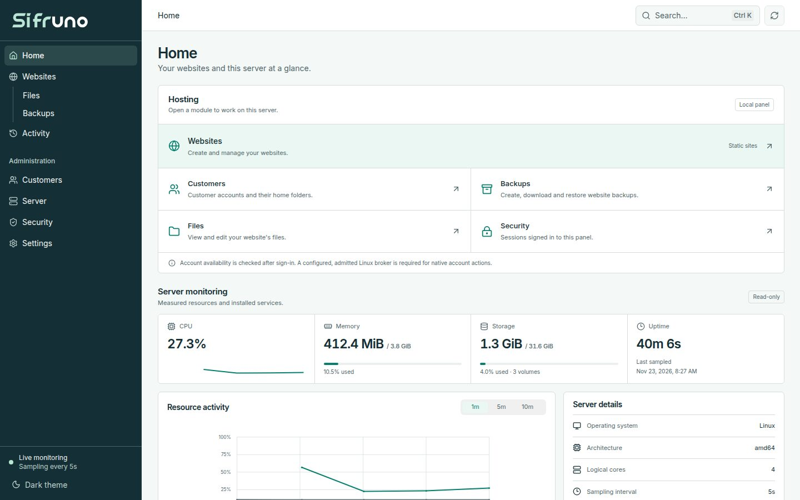

# Sifruno

Sifruno is an open source hosting panel. The goal: a new user gets a WordPress site live in two minutes, a developer deploys an app in any language with `git push`, and an AI agent can do the same through the API. The first customer is HostLelo itself.

**Status: Phase 1, not yet for paying customers.** Sifruno installs with one command on a new AlmaLinux 9 server and hosts WordPress and PHP sites on OpenLiteSpeed. It has the New website wizard with SSL, a page per website with tabs, databases with one-click phpMyAdmin, a file manager, cron jobs, logs and usage, per-account limits, off-server backups with a restore drill, customer logins, a WHMCS module, and moving a website from a cPanel server. The scripts that prove each one on an AlmaLinux 9 server are in `scripts/devvm/proofs/`, and saved runs are in `docs/proofs/`. Before a paying customer: a person reviews the root broker, sign-in and permissions code (commits marked "needs human review"), and migration is proven on HostLelo's own cPanel servers. The [product plan](docs/PRODUCT-PLAN.md) says what gets built, in what order, and what "done" means for each phase.



## Install

To install on a server, follow [docs/installation.md](docs/installation.md): build the release, copy it to a new AlmaLinux 9 server whose `/home` is its own XFS filesystem with quota, and run the installer. To run the panel on your own machine for development, build from source on Linux with Go 1.27.1 and Node.js 24.19.0:

```bash
npm ci --ignore-scripts --no-audit --no-fund
npm --prefix web ci --ignore-scripts --no-audit --no-fund
npm run panel:build
go build -buildvcs=false -o bin/sifruno ./cmd/sifruno
go build -buildvcs=false -o bin/panelctl ./cmd/panelctl
./bin/sifruno --listen 127.0.0.1:8080 --sites-listen 127.0.0.1:8082 --state "$HOME/.sifruno-state" --ui web/dist
```

Then open `http://127.0.0.1:8080`. The [installation guide](docs/installation.md) covers sign-in, the CLI, Windows and troubleshooting. To run the hosting proofs on a real AlmaLinux 9 guest, see the [dev VM guide](scripts/devvm/README.md).

## Where things are

| Path | What it holds |
| --- | --- |
| [docs/PRODUCT-PLAN.md](docs/PRODUCT-PLAN.md) | The plan: scope, roadmap, phase gates, the "not now" list |
| [AGENTS.md](AGENTS.md) | Working rules for people and AI agents |
| `cmd/`, `internal/` | Go server, CLI, root broker and hosting packages |
| `web/` | Panel UI (React, TypeScript, Tailwind) |
| [docs/brand-guidelines.md](docs/brand-guidelines.md) | The V3 brand: logo, colours, type |
| [docs/reference/](docs/reference/) | Notes behind the frozen WHM API layer |
| [docs/archive/](docs/archive/README.md) | Delivery notes and evidence from before the plan |

## Licence

Sifruno Community is [AGPL-3.0-only](LICENSE), with no per-account fee. Third-party code, fonts and icons keep their own licences. See [LICENSING.md](LICENSING.md).
